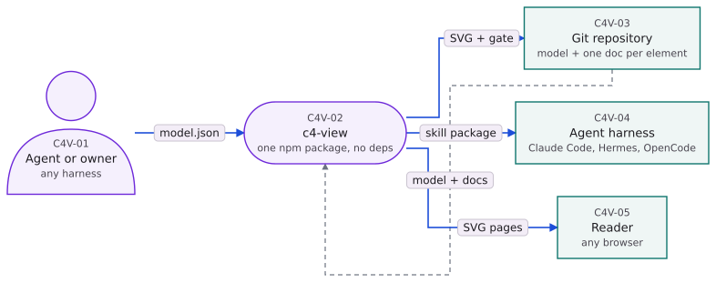

# c4-view

**A C4 architecture renderer an agent can drive.** A JSON model goes in; a deterministic SVG, a PNG, a
self-contained HTML page and a live viewer come out. There is no editing UI — the agent writes the model,
the tool lays it out, and an audit decides whether it is fit to deliver.


[](https://github.com/chaits98/c4-view/blob/main/docs/security/REPORT.md)

**Security:** every version's scanners are recorded in
[`docs/security/REPORT.md`](https://github.com/chaits98/c4-view/blob/main/docs/security/REPORT.md) — gitleaks over the whole history, Semgrep and SonarQube
over `src/`, `npm audit`, and three skill scanners, regenerated by the release itself.



```bash
npm i -g c4-view
c4v skill install                          # teach your agent to write models worth drawing
c4v render docs/c4/c4-view.json --out out --png --strict
c4v serve --port 8788                      # grid at http://127.0.0.1:8788/
```

---

## Why this exists

Graph tools place boxes first and fix the wires afterwards. The renderer inside the app this came from runs
mermaid/dagre and then ~1,600 lines of post-processing to re-route edges, nudge labels and recompute spacing
— and still ships with 26 of 121 nodes carrying a hand-dragged offset.

`c4-view` reverses the order: **space for the wires is allocated during layout**, so overlap is impossible
by construction rather than corrected after the fact. The same model always produces byte-identical SVG,
so two agent runs can be diffed.

## What you get

Two halves, installed separately:

| | |
|---|---|
| **The CLI** (`c4v`) | validates, lays out, routes, audits, renders, serves. Zero runtime dependencies, no config file, nothing downloaded at install time. |
| **The skill** (`skill/SKILL.md`) | teaches a coding agent how to write a model that survives the audit: survey first, decide what kind of system you are looking at, one box per thing, a door in and a door out. Installed into every harness it can find. |

The skill is **copied** into each harness directory, not linked, so it keeps working when the package moves —
and it does not follow an upgrade by itself. After `npm i -g c4-view@latest`, run `c4v skill install --global`
once: `c4v skill list` prints `stale <version>` for a copy written by an older package, `installed` when it is
current.

Without the skill, "draw me a C4 of this repo" gets mermaid soup. With it, the agent surveys the manifests,
picks the right level for the repo's shape, writes the model, runs the audit, fixes the **model** until every
geometry gate is zero, writes the one-sentence `desc` every edge needs for the narration, and hands over a
receipt: the audit line per level, the rendered files, and a link.

## Install

```bash
npm i -g c4-view          # from the registry
# or from a checkout:
git clone <this repo> c4-view && cd c4-view && npm install -g . && c4v doctor
```

| requirement | why |
|---|---|
| **Node 22.18+** | a source checkout runs the `.ts` files directly — nothing is transpiled |
| **Chromium / Chrome** *(optional)* | only PNG export uses it. Found at `$C4_CHROMIUM`, then the usual paths, then `PATH`. Without one, `--png` fails with the fix in the message and everything else still works |
| **A font** | widths come from a committed DejaVu advance table, so measurement is identical on every machine |

`c4v doctor` names whatever is missing, with the command that fixes it.

## Commands

```bash
c4v render <model.json> [--level <path>] [--out <dir|file.svg>] [--png] [--scale 2] [--strict]
c4v audit  <model.json> [--json] [--strict]
c4v serve  [--port 8788] [--root ~/.c4-view] [--host 127.0.0.1] [--token <t> | --no-token]
c4v doctor
c4v service install|status|uninstall        # the viewer as a systemd USER unit
c4v skill  list|install [--global] [--harness id,id]
c4v publish <model.json>                    # model + docs into the viewer's store
c4v gate   install|check --staged|defer|status|report|uninstall
c4v prefs  pending|show|set|greeting
```

## The audit is the product

```
OK level="" nodes=7 edges=8 node∧node=0 wire∧node=0 wire∧wire=0 chip∧chip=0 chip∧node=0 group∧node=0
   crossings=1 (0.12/edge, crisp) backward=0 aspect=5.2
```

Six gates are held at **zero** — `node∧node`, `wire∧node`, `wire∧wire`, `chip∧chip`, `chip∧node`,
`group∧node` — and two numbers are reported rather than gated: `crossings` and `aspect`. Crossings per edge
prints a verdict (`crisp ≤0.5`, `ok ≤1`, `dense ≤2`, `over >2`), because a picture that needs a magnifier to
follow a wire is a model problem, not a layout problem.

`--strict` exits 1 when any gate fails, so a pipeline can refuse to publish. `test/audit.test.ts` plants one
deliberate defect per gate: a grader that only ever prints zeroes proves nothing.

## Two ways to read one model

| mode | what it draws |
|---|---|
| **drill** | one level at a time, with the box you clicked expanded in place and the outside world re-attached through explicit `ports` |
| **full diagram** | every level at once — each container's contents drawn inside its own frame, nested as deep as the model goes |

Both come from the same pipeline; the full view lays each level out in its own space and nests the finished
drawings, which is why a container's chain stays readable instead of competing for columns with the rest.

**The flow is narrated, one edge at a time.** Every edge carries a `desc`; the bar at the bottom plays it as a
second line under the caption (`Git repository → c4-view · model + docs · 2 / 5`), the same sentence appears when
you hover the edge, and **its length sets the pace** — `900 ms + 55 ms per character`, capped at 7 s, so a
sentence is not rushed past at a fixed beat. While it plays, the two nodes the edge joins and the edge itself
stay at full strength and everything else drops to 40%: the packet is the only thing moving at contrast.

A model written before `desc` existed still opens — the field defaults to `''` — and the page says so under the
bar: *"12 edges have no description yet. Ask your agent to describe the flow and watch it play out."*
`c4v audit --strict` names every one of them by level (`level "(root)": 5 edge(s) with no desc — agent->repo, …`),
so an agent that promised a narrated flow gets told what is missing rather than shipping a mime.

## Exports

`Download` in the viewer, or the CLI:

| file | what it is |
|---|---|
| `.svg` | the drawing, vector, carrying its own background so it reads anywhere |
| `.png` | the same picture rasterised (needs Chromium) |
| `.html` | a self-contained page — inline SVG, inline CSS, the flow narration inlined, no server, no network |
| `.layers` | the full diagram as one page |

Every export keeps the theme you are looking at and names itself after what it shows (`c4-view-full.svg`).

## Keeping the diagram honest is a choice you make once

```bash
c4v gate install
```

Any commit that touches code outside `docs/c4/` must then update the model and its docs — or record one line
saying why no diagram change was warranted:

```bash
c4v gate defer --reason "rename only, no topology change"
```

The line is tied to the exact staged diff, so it cannot cover a later edit, and `c4v gate report` lists every
one for review. Skip the gate and the tool still works exactly the same — the diagram simply goes stale
without telling anyone. That is the trade, stated up front: one line per commit, or a diagram you cannot trust.

## The model, in one level

```json
{
  "id": "shop",
  "title": "Shop",
  "levels": [{
    "path": "",
    "title": "Containers",
    "nodes": [
      { "id": "web", "label": "Storefront", "subtype": "web-application", "tech": "React 19", "identity": "SHP-2" },
      { "id": "api", "label": "API", "subtype": "microservice", "tech": "FastAPI", "identity": "SHP-3" }
    ],
    "edges": [{ "from": "web", "to": "api", "label": "REST",
                "desc": "The storefront posts the basket; the API answers with a priced order." }],
    "ports": { "user->shop/web": "router" },
    "flow": ["web->api"]
  }]
}
```

An edge has two things to say: `label`, the headline word on the wire (`REST`, `writes`), and `desc`, the one
sentence on what crosses — 60–140 characters, played in the narration and shown on hover. `subtype` is one of
49 C4 types and decides shape and colour. A node is drillable when a level exists at `<parent path>/<node id>`. `ports` says where an outside edge enters a drilled box. `flow` declares the
narration order; without it, one is derived deterministically.

The authoring rules, the delivery contract and the troubleshooting table live in
[`skill/SKILL.md`](skill/SKILL.md) — that is the document an agent reads.

## How it works

```
model.json → parse → rank → order → place → route → labels → emit → svg
                                   ↘ audit (gates the result)
```

| stage | guarantees |
|---|---|
| parse | every rejection names its place: `levels[2].edges[7].to: unknown node "x"` |
| rank | longest-path layering, cycles broken into backward chains, one dummy per rank a long edge crosses |
| order | six barycentre sweeps, best crossing count kept, ties stable by input order |
| place | measured boxes from a pinned font table, gutters widened to their wire load |
| route | orthogonal; **one track per jog per gutter**, so two wires can never share a segment |
| labels | chips ride their own wire, never over another chip or a node |
| emit | one `<svg>`, colours as attributes, every agent-written string escaped |
| audit | the six gates plus crossings and aspect, computed from the emitted numbers |

Each of the ~50 source files stays under 300 lines, which the contributor gate enforces.

## Footprint

Measured on a laptop, not estimated:

| what | number |
|---|---|
| runtime dependencies | **0** |
| package, unpacked | 758 kB (205 files) |
| package, tarball | 239 kB |
| RSS while serving | 95 MB (~42 MB of it is Node) |
| render speed | 11 levels in **50 ms** |
| skill, input tokens | ~4,200 tokens, instructions only, no bundled code |

## Contributing

```bash
./scripts/check.sh          # everything below, in order
```

| gate | what it refuses |
|---|---|
| `node tools/gate.mjs` | any file over 300 lines, impure layout code, `any`, placeholders |
| `npx tsc --noEmit` | non-strict types |
| `node --test` | any failing test (480 of them, including the audit's own defects) |
| goldens | any change to the corpus output that was not intended |
| `sonar-scanner` | any **unresolved** issue, not merely any new one — a smell that ages out of the new-code window is still a smell |
| coverage | below 95% overall, or below 100% on lines the branch adds |

Determinism is part of the contract: no clocks, no randomness, no locale-dependent sorting. A change that
makes two runs differ is a bug even if the picture looks fine.

## Layout

```
src/            the pipeline: model → layout → svg → audit, plus the CLI and the HTTP server
public/         the viewer: page, styles, pan/zoom, flow narration
test/           480 tests: units, the real corpus, planted defects, install and prefs
examples/       three hand-authored models: containers + drill, boundaries, and a nested three-level model
docs/c4/        this tool's own C4 model, one markdown doc per node and edge
docs/           LAYOUT-SPEC.md (normative) · HTTP-API.md · security/ · design/
skill/          SKILL.md — the document an agent reads
```

## Security

The package has **zero runtime dependencies**, the viewer is read-only, and the skill is a text document —
so the attack surface is the HTTP server you choose to run. What has actually been scanned, and with what:

| surface | tool | result |
|---|---|---|
| skill instructions | SkillSpector 2.12 (static), cisco-ai-skill-scanner 2.3, skillfrisk 0.3, agentscan 1.2 | **0 issues** / 0 findings; agentscan lists 2 low "observed patterns", no verdicts |
| package code | Semgrep `p/security-audit` + `p/typescript` | 0 findings across `src/` |
| package code | SonarQube 9.9 | 0 bugs, 0 vulnerabilities, 0 hotspots, 0 code smells |
| repo + full history | gitleaks 8 | 0 leaks |
| dependencies | `npm audit`, `osv-scanner` | no runtime tree to audit; three dev-only packages |
| runtime | threat model + tests | findings F1–F5: F1/F2 fixed (token printed to a non-tty log; `?t=` kept in the URL), F3–F5 accepted and documented |

The full report — commands, versions, and the threats accepted on purpose — is
[`docs/security/REPORT.md`](docs/security/REPORT.md), reproducible with the container in `security/`. CI re-runs
the four keyless skill scanners and gitleaks on every push.

The report has one section per version and is regenerated, not remembered: `npm version <patch>` runs
`node scripts/security-report.mjs` through the `version` lifecycle script, so the section is written *before*
the bump is committed and tagged, and `npm run report:security` re-runs it on demand. A scanner that finds
something exits non-zero and the version is not tagged.

Report a problem privately via [`SECURITY.md`](SECURITY.md).

## Known ceilings

- A pure chain renders as a long strip: add the real branches, or split the level. Auto-orientation turns a
  >3:1 strip upright when it does not fit 1600 px, and keeps the strip when standing it up would cross more.
- Boundaries need contiguous members; the audit reports when they are not.
- Self-loops are rejected — a self-relationship belongs in `tech`/`desc`.
- PNG export needs a Chromium binary.
- SonarQube analysis needs a project token.

## License

MIT — see [LICENSE](LICENSE).
